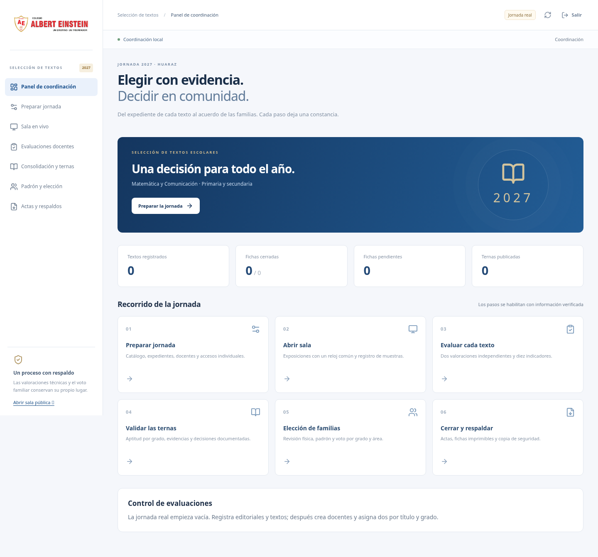

# Selección de textos escolares 2027

Aplicación de la I.E.P. Albert Einstein de Huaraz para registrar expedientes, recibir valoraciones independientes de dos docentes por título y grado, validar ternas y registrar la elección familiar. Incluye Matemática y Comunicación, primaria 1.º–6.º y secundaria 1.º–3.º.

Esta aplicación tiene código y tablas propios (`textos_*`). No modifica los registros de Círculos de Estudios. El guion original está en [REQUISITOS.txt](REQUISITOS.txt).

## Recorrido de coordinación en cinco pasos

1. **Instalar y abrir.** Elija nube gratuita o servidor local según las instrucciones siguientes. Entre como Coordinación. La jornada real inicia vacía; la demostración es otro espacio. Defina fecha, lugar, representación mínima y pautas de práctica antes de recibir fichas.
2. **Preparar e importar.** En Preparar jornada registre editoriales, series, ofertas y un título exacto por grado/edición. Complete el expediente común, registre docentes/asistencia y asigne dos docentes distintos. Las plantillas CSV se descargan desde la aplicación; también admite XLSX. Revise los errores de la previsualización antes de confirmar. Genere y entregue privadamente un código individual a cada docente.
3. **Evaluar.** Cada docente entra con su código y responde diez indicadores sin ver las valoraciones de su colega. Verifique «Guardado en servidor» y cierre explícitamente cada ficha. Coordinación puede reabrir con motivo; no puede emitir puntajes por el docente.
4. **Publicar y votar.** En Consolidación revise pendientes, aptitud por grado y empates. Registre el retiro de editoriales y la validación de Dirección. Después acredite el padrón, confirme la revisión física y abra una sola modalidad por grado/ronda. Papel es la modalidad inicial. La votación digital usa fichas anónimas de un solo uso.
5. **Cerrar y exportar.** Concilie el escrutinio por área y cierre cada ronda. Una segunda vuelta afecta solo el grado y área empatados. Descargue actas, fichas A4, tarjetas, datos y respaldo privado en Actas y respaldos. Los espacios de firma deben completarse en el documento: cerrar en pantalla no equivale a una firma formal.

El [manual](MANUAL.md) detalla el procedimiento, recuperación de conexión y restauración. El [informe de validación](VALIDACION.md) distingue pruebas locales y publicación.



## Opción A: nube gratuita

Se usa un sitio estático en Cloudflare Pages y PostgreSQL/Supabase Free. No se necesita contratar un dominio. Los equipos requieren Internet. Los límites y suspensión por inactividad del plan gratuito se consultan en el panel del proveedor; haga una prueba antes de la jornada.

1. En el proyecto de Supabase existente, abra **SQL Editor**, pegue el archivo completo [supabase/schema.sql](supabase/schema.sql) y pulse **Run**. Se ejecuta como propietario, crea exclusivamente objetos `textos_*` y puede repetirse sin borrar datos. No ejecute `bootstrap-local.sql` en Supabase.
2. La migración autoriza como coordinación el usuario de Authentication ya creado para `coordinacion.academica@ae.edu.pe` (UUID `b5f3904c-4557-4779-9879-33068ae28fa8`). Su contraseña sigue siendo la del usuario de Authentication. Los docentes usan códigos individuales creados desde la web, sin cuentas de correo.
3. Revise [public/config.json](public/config.json). Contiene solo URL pública, clave **publishable** y correo de coordinación. Nunca coloque una clave `service_role`, contraseña de base de datos o contraseña personal en este archivo. Si cambia la URL del proyecto, actualice también `connect-src` en `public/_headers`.
4. Con Node.js 24, ejecute `npm ci` y `npm run build`. La carpeta de publicación es **dist**. Si conecta este código fuente por Git a Cloudflare Pages: Framework **None**, comando **npm run build**, salida **dist**, raíz vacía. Si publica una rama con los archivos ya compilados en la raíz: comando vacío, salida **.**, raíz vacía. No mezcle ambas configuraciones. No se necesita Wrangler.
5. Abra la dirección HTTPS de Pages y compruebe que la pantalla diga **Selección de textos escolares 2027**. Entre como Coordinación, primero en Demostración. El enlace Sala pública permite proyectar sin iniciar sesión y excluye fichas y padrón.

Para otra instalación, cambie el usuario autorizado de `textos_coordinators` durante la instalación, como propietario; no se requieren claves administrativas en el navegador. Las tablas no admiten acceso directo del navegador: la función `textos_api` comprueba el rol en cada operación.

## Opción B: servidor del colegio, sin Internet durante la jornada

Requisitos para la instalación inicial: Docker Engine con Compose y Node.js 24. La descarga inicial de imágenes y dependencias necesita Internet; después se puede operar en la red local sin correo ni servicios externos.

```bash
cd seleccion-textos-2027
./scripts/local-start.sh
```

El comando crea contraseñas aleatorias locales en `local/.env`, inicia PostgreSQL, PostgREST y el servidor web, y deja el código de coordinación en `local/owner-code.txt`. No publique estos archivos. Para ver su código en su propia computadora:

```bash
cat local/owner-code.txt
```

Abra `http://localhost:8080`, elija Jornada real → Coordinación y use ese código. Para la demostración use el código de `local/demo-owner-code.txt`. No es la contraseña de la nube.

En otro equipo conectado a la misma red, abra `http://IP-DEL-SERVIDOR:8080` (por ejemplo, la dirección IPv4 que muestra `ipconfig` en Windows o la configuración de red del servidor). Permita el puerto 8080 en el cortafuegos de la red privada. Mantenga el servidor encendido y sin suspensión automática. No exponga ese puerto directamente a Internet.

HTTP local permite guardar en el servidor y conservar temporalmente el borrador en memoria durante una caída. Los borradores locales cifrados que sobreviven al cierre del navegador requieren un contexto seguro: HTTPS o localhost. Para HTTPS local configure un certificado confiable para los dispositivos y `TLS_CERT_FILE`/`TLS_KEY_FILE` en el servidor Node o un proxy HTTPS del colegio. La interfaz informa cuando el navegador no permite guardar el borrador cifrado. No cierre ni recargue una pestaña sin sincronizar.

Detener y volver a abrir conserva los datos:

```bash
./scripts/local-stop.sh
./scripts/local-start.sh
```

No use `docker compose down -v`: eliminaría el volumen persistente. Guarde también una copia privada descargada desde la aplicación.

## Desarrollo y pruebas

```bash
npm ci
npm test
npm run build
```

Para desarrollar la interfaz: `npm run dev`. Para la base local use Compose; `npm start` sirve `dist` y reenvía las solicitudes a `POSTGREST_URL` (por defecto `http://127.0.0.1:3000`). Vite reenvía `/api` al servidor Node del puerto 8788.

Las pruebas PDF usan `pdftotext` de Poppler para abrir y comprobar el contenido; instale `poppler-utils` en Linux si no está disponible. No se requiere para usar la aplicación. La prueba completa de navegador se ejecuta en una instalación local descartable con `node --import tsx tests/browser-local.mjs` (Chromium en `/usr/bin/chromium` o `CHROMIUM_PATH`). Usa solo la demostración; no la ejecute contra la base de una jornada en curso.

Las pruebas SQL utilizan servicios Docker aislados y datos ficticios, sin conectarse a producción. Consulte `scripts/test-db.sh` y el informe de validación entregado. La migración, el control de versiones y el recuento transaccional son el mismo código tanto en nube como en red local.

## Datos y privacidad

- Las fichas guardan enteros 0/1/2 o pendiente; no hay puntajes precargados en la jornada real. Un dato desconocido conserva `null`.
- El puntaje individual es cinco veces la suma de diez indicadores. La nota por grado promedia dos docentes distintos. La nota de bloque promedia todos sus grados sin redondear para ordenar.
- El expediente común conserva fuentes y verificaciones humanas. La aplicación no certifica registros OBNATE ni reemplaza el control ministerial.
- Los códigos de acceso y voto se conservan como huellas. Las opciones digitales se suman de forma atómica a contadores agregados, sin almacenar una cédula individual ni un vínculo sección/código/opción.
- La demostración se carga y reinicia solo en `demo`. La base real queda vacía hasta que coordinación registre datos auténticos.
- Un respaldo privado contiene información administrativa y huellas de códigos de voto, nunca los códigos originales. La restauración no restablece códigos consumidos; si la copia es anterior a votos conocidos, suspende la ronda y exige conciliación documentada.

Los PDF dejan espacios de firma, no simulan firmas oficiales ni envíos a autoridades. Los acuerdos pendientes se muestran como tales; una nota técnica nunca sustituye un empate familiar.
